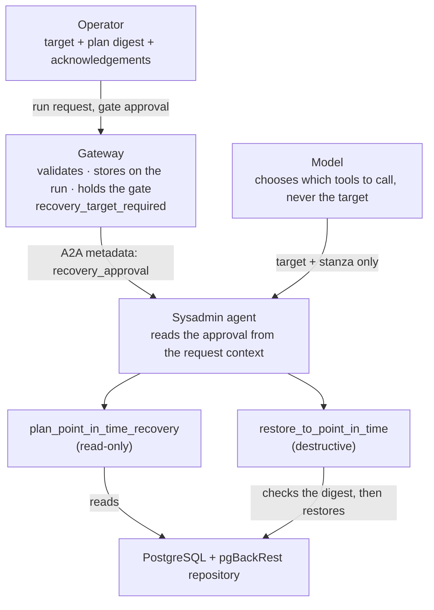
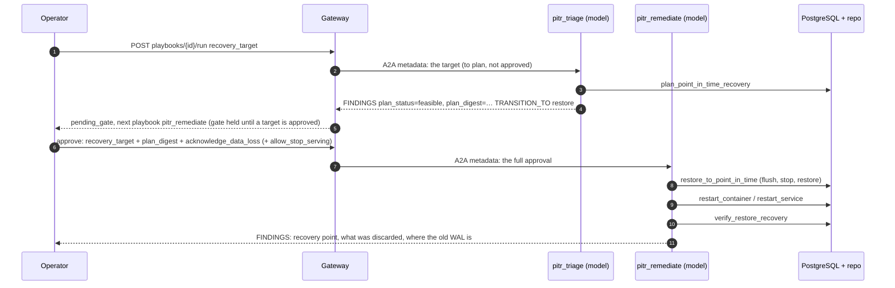

# aiHelpDesk Point-in-time recovery (PITR)

`restore_from_backup` ([BACKUP.md §3](BACKUP.md#3-restore-from-backup-after-data-loss)) puts a database back
as it was at the **end of the archive**. That is the right answer when the data directory is gone. It is the
wrong one when the damage is in the latest data: a table dropped by mistake, a bad deploy, logical
corruption, etc. Replaying the archive to its end replays the damage. Point-in-time recovery restores the
database as it was at a moment **a person chose** and discards everything after it. Yes, that means data loss, but a deliberate one.

aiHelpDesk does this for a single pgBackRest-managed PostgreSQL instance, to a **time** or an **LSN**, whether
the instance is down or still serving.

| | `restore_from_backup` | point-in-time restore |
|---|---|---|
| Restores to | the end of the archive | a time or an LSN a human chose |
| Instance | down only | down or **running** (the gate must allow stopping it) |
| Who chooses the end point | nobody: pgBackRest's default | a human, never the model |
| Discards | nothing archived | everything committed after the target |
| Started by | the data-loss chain, automatically after a gate | a person, with the target, through a gate they approve |
| Playbooks | `pbs_pgbackrest_restore_remediate` | `pbs_pgbackrest_pitr_triage` → `pbs_pgbackrest_pitr_remediate` |

What is verified and where, is in [§8](#8-whats-verified). What it does **not** do is in [§7](#7-limits).

## 1. The safety model

A restore that stops at the wrong moment destroys data silently. So the one input that decides how much is
thrown away, the recovery target, is kept out of the model's reach entirely and every step that could
destroy data is bound to what a person looked at.

1. **The target is a structured field a human supplies.**   
   `recovery_target` is `{"type": "time"|"lsn", "value": ...}` on the run request and again on the gate approval. Go validates its shape. It reaches the
   sysadmin agent in the A2A message metadata (`recovery_approval`) and the restore tool reads it from the
   request context. The model-facing `restore_to_point_in_time` takes only `target` (which instance) and
   `stanza`: it has no argument for where to stop and a model cannot pass, change or invent one. Without an
   approval it refuses outright.
2. **The approval is bound to a plan.**   
   The dry run, `plan_point_in_time_recovery`, reports which backup would
   be restored, whether the archived WAL is continuous, what would be discarded and a **plan digest**: a
   short hash of the stanza, the backup, the target and the timeline. The operator approves *that digest*. The
   restore recomputes the plan from the repository and refuses if it no longer matches.
3. **The chain always stops at a human.**   
   The boundary into `pbs_pgbackrest_pitr_remediate` is a gate with
   reason `recovery_target_required`. No approval mode passes it, `force` included and neither does
   `skip_trust_gate`. The playbook cannot be started directly (`409`).
4. **Stopping a running instance is a separate authorization.**   
   `allow_stop_serving` is its own flag on the approval. Approving the target does not imply it.
5. **The target is immutable.**   
   The run stores its target (`recovery_target` on the run record). A gate approval may restate it, never change it (`409`).
6. **Data loss is acknowledged.**   
   `acknowledge_data_loss: true` is required: everything committed after the target is discarded.



## 2. The pieces

| Piece | What it is | Where |
|---|---|---|
| `plan_point_in_time_recovery` | Dry run. Read-only. Selects the backup (the newest that finished before the target), checks WAL continuity to the end of the archive, places the target in the archive, reports what would be discarded and the digest | [tools page](tools/sysadmin.md#plan_point_in_time_recovery) |
| `restore_to_point_in_time` | The restore. Destructive, policy-gated. Down or running instance | [tools page](tools/sysadmin.md#restore_to_point_in_time), [MUTATION_TOOLS §1.15.1](MUTATION_TOOLS.md#1151-restore_to_point_in_time--restore-to-a-recovery-target) |
| `verify_restore_recovery` | After the restart: reads PostgreSQL's own log and checks it stopped at the target | [tools page](tools/sysadmin.md#verify_restore_recovery) |
| `pbs_pgbackrest_pitr_triage` | Entry-point playbook. Read-only: plans the target, reports the plan, hands on to the restore only if it is feasible | [`playbooks/pgbackrest-pitr-triage.yaml`](../playbooks/pgbackrest-pitr-triage.yaml) |
| `pbs_pgbackrest_pitr_remediate` | Terminal playbook: restore, restart, check the instance, verify where recovery stopped. Reachable only through the gate | [`playbooks/pgbackrest-pitr-remediate.yaml`](../playbooks/pgbackrest-pitr-remediate.yaml) |
| Gateway fields | `recovery_target` on the run; `recovery_target`, `plan_digest`, `acknowledge_data_loss`, `allow_stop_serving` on the gate | [§4](#4-operating-it) |
| `db-pitr-dropped-table[-k8s]` | The faults that exercise all of the above | [FAULTTEST.md §6.6](FAULTTEST.md#66-point-in-time-recovery-faults-pitr) |

## 3. The flow



For a **running** instance the restore step expands ([§5](#5-a-running-instance)).

## 4. Operating it

Steps 2 and 3 can be done with `helpdesk-client` ([the short way](#the-short-way-helpdesk-client)), with the
API as below, or in the Decision Hub ([DECISIONS.md](DECISIONS.md)). `$GW` is the gateway, `$KEY` a key that may
approve gates.

**1. Start the triage with the target.** Find the playbook, then run it:

```bash
PB=$(curl -s "$GW/api/v1/fleet/playbooks?series_id=pbs_pgbackrest_pitr_triage&active_only=true" \
       -H "Authorization: Bearer $KEY" | jq -r '.playbooks[0].playbook_id')

curl -s -X POST "$GW/api/v1/fleet/playbooks/$PB/run" \
  -H "Authorization: Bearer $KEY" -H "Content-Type: application/json" -H "X-Purpose: diagnostic" \
  -d '{
    "connection_string": "pgbackrest-db",
    "gate_escalation":   true,
    "recovery_target":   {"type": "time", "value": "2026-10-28T14:05:00Z"}
  }'
```

A time is RFC3339 **with a zone**; an LSN is `X/Y`. A malformed target is a `400` and nothing is recorded. A bare
`2026-10-28 14:05:00` is refused for that reason. To get the right form from the database's own clock:

```sql
SELECT to_char(clock_timestamp() AT TIME ZONE 'UTC', 'YYYY-MM-DD"T"HH24:MI:SS"Z"');
```
Use the database's own clock when you note the moment: `SELECT clock_timestamp()`.

**2. Read the plan.** The response is `pending_gate` with `transition_target` `pbs_pgbackrest_pitr_remediate`
(`gate_reason` is reported only when the request did not set `gate_escalation`; the gate holds either way, and an
approval without a target is refused) and the triage's `escalation_findings` carry `plan_status`, `plan_digest`, `backup_label`, `timeline`,
`archive_end_time`, `data_loss`, `instance` (down or serving) and `archive_flush_required`. The digest in
those findings was reported by a model. To review the plan itself, ask the sysadmin agent, as the harness
does:

```bash
curl -s -X POST "$SYSADMIN/tool/plan_point_in_time_recovery" \
  -H "Authorization: Bearer $SYSADMIN_KEY" -H "Content-Type: application/json" \
  -d '{"trace_id":"tr_review_1","purpose":"diagnostic","args":{"target":"pgbackrest-db","stanza":"main",
       "recovery_target_type":"time","recovery_target_value":"2026-10-28T14:05:00Z"}}' | jq -r .output | jq .
```

Read `status`, `backup_label`, `data_loss`, `instance_serving`, `archive_flush_required` and `plan_digest`. A
plan that is not `feasible` has a `detail` saying why; do not approve around it.

**3. Approve the plan you read.**

```bash
curl -sX POST "$GW/api/v1/decisions/gate:$RUN_ID/resolve" \
  -H "Authorization: Bearer $KEY" -H "Content-Type: application/json" \
  -d '{
    "resolution":            "approved",
    "resolved_by":           "ops@example.com",
    "approval_mode":         "auto",
    "recovery_target":       {"type": "time", "value": "2026-10-28T14:05:00Z"},
    "plan_digest":           "3c7ae8cf0d79ffd9",
    "acknowledge_data_loss": true,
    "allow_stop_serving":    true
  }'
```

The same body goes to `POST /api/v1/fleet/playbook-runs/$RUN_ID/proceed-escalation`. `allow_stop_serving` is
needed only when the instance is serving. Leave it out for a database that is already down.

| The gateway refuses with | Because |
|---|---|
| `400` needs the recovery target | the approval has none or it is malformed |
| `400` needs plan_digest | missing or not the 16-hex-character digest |
| `400` needs acknowledge_data_loss | not `true` |
| `409` cannot be changed once set | the target differs from the one the run was started with |
| `409` can only be reached through a gate | someone tried to run `pbs_pgbackrest_pitr_remediate` directly |

A refusal changes nothing: no state is written and no agent is called. Denying the gate
(`"resolution":"denied"`) needs none of these fields.

**4. After it.** The remediation's findings give the backup restored, the recovery point PostgreSQL logged
(`recovery stopping …`, `redo done at`, the new timeline), what was discarded and `saved_wal`.
Then:

- **Take a fresh full backup.** The database is on a new timeline.
- **Remove `saved_wal`** (`pg_wal.saved-<time>`, beside the data directory or in the pgBackRest repo volume on
  Kubernetes) once you are sure you do not need it. It holds the WAL that was in the data directory, including
  anything written after the target. It is never removed automatically ([BACKUP.md](BACKUP.md) has the open
  decision on who cleans these up).
- **If the target was wrong,** `restore_from_backup` restores to the end of the archive again: the backups and
  the archived WAL are untouched. See [§7](#7-limits) for what that cannot undo.

### The short way: `helpdesk-client`

```bash
export HELPDESK_GATEWAY_URL=$GW HELPDESK_CLIENT_API_KEY=$KEY
export HELPDESK_SYSADMIN_URL=$SYSADMIN HELPDESK_SYSADMIN_API_KEY=$SYSADMIN_KEY

# Read the plan the agent computes for that target (read-only). It prints the facts to decide on and,
# for a feasible plan, the exact approve command, digest included.
helpdesk-client --pitr-plan --pitr-server pgbackrest-db \
  --recovery-target-type time --recovery-target 2026-10-28T14:05:00Z

# Approve that plan for the triage run holding the gate.
helpdesk-client --user ops@example.com --pitr-approve plr_a3f7c1b2 \
  --recovery-target-type time --recovery-target 2026-10-28T14:05:00Z \
  --plan-digest 3c7ae8cf0d79ffd9 --acknowledge-data-loss --allow-stop-serving
```

Nothing is defaulted: a missing or malformed target, a digest that is not 16 hex characters, or no
`--acknowledge-data-loss` is refused before anything is sent, and the gateway's own refusals are printed as
they come ([§4 table](#4-operating-it)). `--pitr-plan` prints no approve command for a plan that is not
feasible. Denying a gate does not need any of this.

## 5. A running instance

A dropped table leaves the database serving, so this is the common case. With `allow_stop_serving` the
restore does the following, **in this order**. Every step before the stop leaves the instance running and a
failure at any of them says so.

1. **Ask the instance about itself** (`psql`, local socket).   
   It refuses a standby, any replica in `pg_stat_replication`, `archive_mode` other than `on` or `always`, a running HA manager (Patroni, repmgr,
   pg_auto_failover, Stolon: matched by process name), an LSN target ahead of the instance's WAL position or
   a time target ahead of its own clock. Its position, timeline and clock are recorded as `pre_stop` in the
   result.
2. **Flush the archive.**   
   `pg_switch_wal()`, then wait until no completed segment is waiting in
   `archive_status` and the archiver's `failed_count` has not moved. The target may be in WAL that had not
   been archived yet; this is why the plan of a serving instance can say `archive_flush_required: true` and
   still be feasible. If the flush cannot be confirmed, it refuses.
3. **Plan again from the repository**   
   Until the flushed WAL is in it (pgBackRest's asynchronous archive
   acknowledges a segment before it is there). The plan must be feasible, no longer need a flush and carry
   the approved digest.
4. **Stop it and keep it stopped:**  

   | Platform | How | Needs |
   |---|---|---|
   | Docker / Podman | clean `pg_ctl stop -m fast`, then `<runtime> stop`; the restore runs in a throwaway container from the instance's image on its volumes | the image carries `/etc/pgbackrest.conf` (or it is on a volume) |
   | systemd VM | `sudo systemctl stop <unit>` over SSH | a sudoers grant for `systemctl stop <unit>` (`testing/docker/setup-pgbackrest-vm.sh` adds it) |
   | Kubernetes | clean stop, then the StatefulSet is scaled to 0; the restore runs in a one-off pod on its volumes | the chart's RBAC (the same as `restore_from_backup`) |

   Then it confirms the instance no longer answers.
5. **Run the restore script.**   
   It refuses a standby, a live postmaster or too little room beside the data
   directory for the saved WAL. If it refuses *before changing anything*, the instance is **started again**.
   If pgBackRest itself fails partway, the instance **stays stopped**, the error names `saved_wal` and the
   fix is to run the same restore again.

The instance is left stopped on success too: the playbook starts it with `restart_container` or
`restart_service` and PostgreSQL's recovery runs on startup and stops at the target. Two restores of the same
target cannot overlap: a second call (a model retrying a slow one) is refused while the first runs.

## 6. Checking where recovery stopped

`verify_restore_recovery` reads PostgreSQL's log after the restart. For a point-in-time restore it checks the
`recovery stopping …` line (which side of the target it fell on), `redo done at` and the new timeline.

| Status | Meaning | What to do |
|---|---|---|
| `verified` | stopped at the target, on the predicted timeline | nothing |
| `target_not_reached` | the archive ran out of WAL before the target; PostgreSQL shut down with `recovery ended before configured recovery target was reached` | the data directory is intact and **the instance is not running**. Repeat the restore with an **earlier** target; do not just restart |
| `mismatch` | PostgreSQL did not stop where the target says | stop and investigate; do not retry |
| `not_found` | no completed recovery in the log yet | call it again once the instance is up |
| `unverified` | no prediction on record (the agent restarted since the restore) | the recovery point is unconfirmed, not wrong |

`target_not_reached` and `mismatch` also raise objective-evidence signals
(`restore_target_not_reached`, `restore_recovery_mismatch`, [OBJECTIVE_EVIDENCE.md](OBJECTIVE_EVIDENCE.md)).
A feasible plan only says the target is *plausible*: a time target can only be placed by the repository's
per-segment times, so recovery can still run out of WAL, for example when nothing was committed between the
target and the last archived segment.

## 7. Limits

Stated plainly, so they are not discovered during an incident:

- **One instance.** A standby, an instance with replicas and one under an HA manager are refused: the
  restore forks the timeline and every replica would have to be rebuilt. Patroni and similar are detected by
  process name only.
- **Time and LSN only.** Named restore points and transaction IDs cannot be checked against the archive
  before PGDATA is overwritten, so they are not offered.
- **Whole-archive continuity.** The WAL must be continuous from the selected backup to the **end** of the
  archive, not just to the target. A gap after the target refuses the plan; a human decides.
- **The archive's newest timeline.** The restore pins it. Undoing an earlier point-in-time restore (a target
  on an older branch) is not supported.
- **Time is coarse.** A feasible time target is plausible, not certain ([§6](#6-checking-where-recovery-stopped)).
  An LSN is exact and must be a position the instance has passed. Take it on a quiet database right after the
  commit you want to keep.
- **Writes between the flush and the stop are discarded.** They are after the target by definition. They survive
  only in `saved_wal`: the saved WAL is not pushed to the archive.
- **A colocated deployment** (no infrastructure config) cannot be stopped and restored by this tool.
- **Remote repositories and multi-node ReadWriteOnce volumes** are as unsupported as for `restore_from_backup`
  ([PLATFORMS.md §6](PLATFORMS.md#6-not-supported-or-not-verified)).
- **Not wired into the data-loss chain.** `pbs_db_data_loss_triage`'s `pitr_decided` still never routes into
  this pair: a person starts the PITR triage directly with a target.
- **One agent replica.** The guard against overlapping restores is in-process.

## 8. What's verified

Recorded runs are in [PLATFORMS.md §5](PLATFORMS.md#5-verified-combinations).

| | Down instance | Running instance | With a live model |
|---|---|---|---|
| Docker fixture | time and LSN; a target never reached, then retried | yes | **yes** (`db-pitr-dropped-table`) |
| Kubernetes pod | yes, in-cluster | yes, in-cluster | **yes** (`db-pitr-dropped-table-k8s`) |
| systemd VM (Ubuntu, over SSH) | script tested | **yes** (live `sudo systemctl stop`, pgBackRest 2.60.0, services on a laptop) | yes, started and approved by hand (below) |

One live-model run per platform: it shows the chain works, not how reliably the model gets it right. The VM run was
manual, not a catalog fault: there is no `db-pitr-dropped-table-vm` yet. A table was created and populated, an
incremental backup taken, the target noted from the database's clock, a later table created and the first dropped;
the triage was started with `curl`, the plan read with `helpdesk-client --pitr-plan` and the gate approved with
`--pitr-approve ... --allow-stop-serving`. Checked by hand afterwards: the dropped table was back with its 5 rows,
the table created after the target was gone, the cluster was on timeline 45, and the log showed `recovery stopping
before commit`, `redo done`, `selected new timeline ID: 45`, `archive recovery complete`.

**Tests:**

```bash
go test ./...                                                       # unit: pure logic, gateway, harness, scripts in a real shell
go test -tags integration ./agents/sysadmin/ -run 'PITR|PlanPITR|RestoreToPIT'   # needs the Docker pgBackRest fixture
make integration-k8s K8S_SYSADMIN_API_KEY=<key>                    # needs minikube and the deployed agent (rebuild the image first)
```

`make faulttest-pitr` runs the Docker fault with a live model (it needs the host-process stack so the agents reach the fixture; [FAULTTEST.md §6.6](FAULTTEST.md#66-point-in-time-recovery-faults-pitr)).

`TestIntegration_PITRFault_DroppedTable_Catalog` runs the catalog fault end to end without a model.

## 9. When it refuses

| Message contains | Meaning |
|---|---|
| `no approved recovery target for this request` | the tool was called without a gate approval (a model on its own or a run that never passed the gate) |
| `plan changed since it was approved` | the repository changed or the digest is for another target or backup: plan again and re-approve |
| `still accepting connections … allow_stop_serving` | the instance is running and the approval did not allow stopping it |
| `standby`, `replica(s) are attached`, `archive_mode is`, `HA manager` | the instance is not one this tool may restore ([§7](#7-limits)) |
| `could not confirm the archive was flushed` | archiving is failing or too slow; fix archiving first. The instance was not stopped |
| `did not reach the archive after the flush` | the target's WAL is not in the repository. The instance was not stopped |
| `the plan is not_feasible` / `unverified` | the plan's `detail` says why (no backup before the target, a WAL gap, a target past the archive end) |
| `a point-in-time restore of … is already running` | do not retry; wait for the first call's result |
| `the restore refused (…) before changing anything … started again` | the script's safety check fired after the stop; nothing was changed and the instance is back |
| `This tool stopped the instance and it is still stopped` | pgBackRest failed partway: run the same restore again |

## 10. Why it is built this way

- **The digest excludes the end of the archive**   
  On a running instance the archive keeps growing between the
  plan and the restore, so a digest that included it would always drift. The digest is the *decision* (stanza,
  backup, target, timeline); the restore separately requires the archive to hold the target.
- **The saved WAL is not put back or pushed**   
  `restore_from_backup` copies the unarchived tail back and
  archives it because it wants the newest data. Here that WAL is exactly what is being discarded and replaying
  it would defeat the target.
- **`promote`, not `pause`**   
  pgBackRest's other target action leaves PostgreSQL read-only on the old timeline
  with no new timeline to verify.
- **Verification uses `redo done at` and the stop line**   
  Never the last restored segment: PostgreSQL reads
  ahead of the stop point, so that segment is later than where redo ended (found on a real capture).
- **The model gets one tool argument fewer, not a stricter prompt**   
  Telling a model not to choose a target would be a request. Leaving it nowhere to put one is a guarantee.

## Related

[BACKUP.md §3](BACKUP.md#3-restore-from-backup-after-data-loss) (restore-to-latest, the three layers) ·
[MUTATION_TOOLS §1.15.1](MUTATION_TOOLS.md#1151-restore_to_point_in_time--restore-to-a-recovery-target) ·
[DECISIONS.md](DECISIONS.md) (gates and the Decision Hub) ·
[PLATFORMS.md](PLATFORMS.md) · [FAULTTEST.md §6.6](FAULTTEST.md#66-point-in-time-recovery-faults-pitr) ·
[Tool reference](tools/sysadmin.md)
