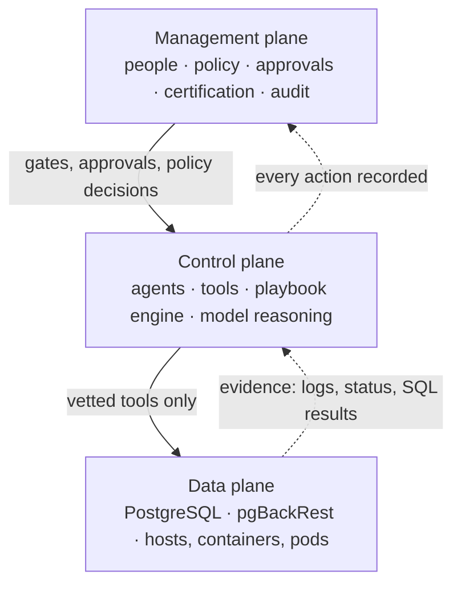

# aiHelpDesk planes, paths and service levels

aiHelpDesk is made of pieces that do very different jobs and fail in very different ways. This page
gives them names (data, control and management plane), then adds two cross-cutting ideas that matter
once you start promising a service level: the **action path** (what an action needs in order to proceed,
which decides availability) and the **decision path** (what a decision rests on, which decides
consistency). It ends with a design note on what a service level for aiHelpDesk could be made of.

What is settled and what is not:

| Part | Status |
|---|---|
| The three planes and the two paths (§1, §2, §3) | **Settled**: the vocabulary this documentation uses |
| What exists today and what does not (§2.3, §3.2) | **Facts** about the current code |
| The service-level structure (§4) | **Design note**: nothing here is measured or offered as an objective yet |

Where each piece can *run* (laptop, Docker, a VM, Kubernetes) is a different question, answered in
[Platforms](PLATFORMS.md). How aiHelpDesk *diagnoses* the HA and DR of the **databases** it protects is
[HA_DR.md](HA_DR.md)'s subject; this page is about aiHelpDesk's own availability.

## 1. The three planes

| Plane | What it is | In aiHelpDesk |
|---|---|---|
| **Data plane** | Where customer data lives and application traffic flows. aiHelpDesk is **not in the data path**: applications talk to PostgreSQL directly and aiHelpDesk touches it only to diagnose or repair. | the target PostgreSQL (primary and replicas), the pgBackRest repository and WAL archive and the containers, VMs or pods that host them |
| **Control plane** | The components that observe the data plane and **act on it**. What defines them is that they change state. | the agents (database, sysadmin, k8s, incident), their vetted tools, the playbook engine that chains and gates hops and the model reasoning behind them |
| **Management plane** | The human and governance side: how people configure, approve, observe and audit. It decides *who may do what* and records it. | `helpdesk-client`, the gateway's HTTP API and the [Decision Hub](DECISIONS.md), the playbook library (vault) and its certifications, identity, roles and [policy](AUTHZ.md), approvals, auditd's audit trail and reports, the auditor/govbot/secbot, `infrastructure.json`, the Helm values; faulttest and fleet-runner as operator tooling |

The boundaries and what guards each:

- **Control → data** only through the [Tool Registry](TOOL_REGISTRY.md#principles): agents have no direct
  access to any infrastructure, only to published, vetted tools, each classified read, write or
  destructive, with the policy check in between.
- **Management → control** through gates and approvals (`force`, `manual`, the Decision Hub) and the
  [trust gate](CONSISTENCY.md) that stops an uncertified playbook from acting on its own.
- **Data → anything:** nothing. The data plane has no dependency on aiHelpDesk and keeps serving if every
  aiHelpDesk component is down.

Two components straddle a boundary. The **gateway** is a management surface (its API, the Decision Hub)
and also the router that gates the next hop of a chain, which is control. **auditd** stores the audit trail
(management) and answers the agents' per-tool-call policy check, which is enforcement on the control plane.
Say which role is meant in a given sentence; do not force either into one box.

## 2. The action path: availability

### 2.1 Why the usual ordering does not hold

The conventional ranking is data plane highest, control plane next, management plane lowest. For
aiHelpDesk three things break it.

1. **Part of the management plane is on the action path.**   
   An agent's remote policy check **fails closed on
   any error** (`policy service unreachable; failing closed`), for reads as well as writes. When auditd's
   policy service is down, every agent stops, even read-only diagnosis, wherever policy is enforced
   through auditd (the Helm and enterprise setup). So the policy decision, identity checking and the
   gate/approval state need control-plane availability, while the rest of the management plane does not.
2. **Demand is anti-correlated with the data plane.**   
   aiHelpDesk is needed *when the data plane is
   failing*. Its availability that matters is *during a data-plane incident*, which is mostly a matter of
   independent failure domains and not of a percentage. One is already a rule: auditd's storage never
   shares a server with a target database. Another follows: do not run the agents where the failure is.
   The in-cluster demo puts the agents in the same cluster as the target pod, which survives a pod crash
   and not a node or cluster loss.
3. **There is an external dependency on the action path.**   
   Without the LLM provider the control plane
   cannot diagnose anything. One vendor and model is configured at a time and there is no failover, so
   the control plane's real availability is capped by the provider's.

### 2.2 The tiers

The planes are by function. Availability is a separate attribute of each component, decided by whether an
action must wait for it:

| Tier | Members | Expectation |
|---|---|---|
| **Data plane** | the target databases and pgBackRest repositories | the customer's own SLO (their database HA) |
| **Action path** | agents, gateway routing and gating, the tools, the identity check, auditd's **policy decision**, the LLM provider | up *during a data-plane incident*, in failure domains independent of the data plane |
| **Observation and administration** | CLI and UI, reports, vault browsing, compliance, faulttest, fleet scheduling | lowest; may be down without blocking any action |

The management plane therefore has members in both of the lower tiers, so it does not have a single
service level.

### 2.3 What is true of the code today

- **Every component defaults to one replica.**   
  It has not been verified that the gateway and the agents are
  safe to run with more.
- **Agents hold some state in memory.**  
  The SysAdmin Agent keeps the restore prediction in a process-wide
  map, so a restart (or a second replica) loses it and `verify_restore_recovery` reports `unverified`.
  Gate and run state, by contrast, is persisted in auditd.
- **The policy decision does not need auditd's storage.**   
  When auditd could not reach its database it still
  returned ALLOW and logged `failed to record policy check event`. The audit-event write is best-effort on
  that path. Whether every code path treats a failed audit write the same way has not been audited.
- **auditd's own backup and disaster recovery are not covered**, in either storage backend.
- **No failover for the model provider.**

### 2.4 The decision that HA forces

Today an unreachable policy service means *no action at all*, reads included. A degraded mode in which
read-only diagnosis continues (with a local policy decision, the missing records reconciled later) while
writes stay blocked would keep aiHelpDesk useful during an outage of its own. It trades the guarantee
"nothing runs without its decision being made centrally" for "diagnosis still works". That is a
governance choice and it is **open**: the current position is fail closed everywhere.

## 3. The decision path: consistency

### 3.1 A deterministic envelope around one probabilistic part

Only one component is probabilistic: the model's reasoning. Everything that bounds it is deterministic
code: the tools' structured results, the [objective-evidence](OBJECTIVE_EVIDENCE.md) signals, the WAL
check, the policy check, the Go-level refusals in `restore_from_backup`, the gates. A promise about decision
consistency is a promise about the probabilistic part **as bounded by** the deterministic part. The most
effective way to raise it is to move decisions out of prose and into code, as was done for
`wal_continuity` and `backup_stale`.

### 3.2 What exists and what does not

| | |
|---|---|
| **Exists** | **Certification:** a repeated-run cert per fault and model; `STABLE` needs a pass rate of at least 80% and a confidence range of at most 30 points ([CONSISTENCY.md §4](CONSISTENCY.md#4-stable-vs-unstable-the-criteria)). **Three named stabilities:** outcome, conclusion (the same root-cause attribution) and evaluation ([ATTRIBUTION_CERTS.md §1](ATTRIBUTION_CERTS.md#1-the-three-named-stabilities)). **A `CLEAN` axis** over warning signals. **The trust gate:** a real incident whose series has no `STABLE`, `CLEAN`, attribution-consistent cert for the current model is held at a human gate (`trust_not_earned`). **Versioned history and regression detection** when a recertification stops clearing that bar. |
| **Does not** | **No runtime measurement:** consistency is a pre-production gate, measured on injected faults in test environments and nothing measures it on real incidents. **No enforced freshness:** a cert older than 30 days only produces a warning, not an expiry. **A small sample:** the criteria are written for a batch of five runs (`--repeat N`). **A single-model assumption:** the gate resolves "the current model" from one gateway-wide value and for a deployment that runs different models on different agents it fails open. **No coverage figure:** there is no count of incident classes certified for autonomous action against all of them. **No correctness:** consistency is not accuracy; a consistently wrong decision is still wrong and the accuracy signal (operator verdicts) is sparse. |

### 3.3 What violates consistency

Not an outage but **drift**: a provider changing the model behind an alias, an edited playbook or prompt, a
changed evidence rule or tool schema, a different inventory context. Each invalidates what a cert measured.
The mechanisms above respond by *removing autonomy*, not by stopping the service: the gate hands the
decision to a human. So consistency and availability interact: aiHelpDesk can be fully available with no
autonomy.

A measured example, from the Docker fixture: the restore hop once stopped without restoring because it
read a running container as a running database. The next three runs, after a one-sentence change to the
playbook, all restored. The inconsistency was real and only repeated runs could show it.

## 4. Service levels: a design note

A service level for aiHelpDesk could be three numbers, because one cannot carry it:

| Level | Question it answers | Measured over |
|---|---|---|
| **Availability** | Is the action path up when the data plane is not? | the action path of §2.2, during data-plane incidents |
| **Autonomy coverage** | For what share of incident classes may it act without a human, under the model now running? | certified series against all series, for the current model |
| **Decision consistency** | Does it decide the same way given the same evidence? | agreement across repeated runs per certified series, with the freshness of the cert |

The second keeps the first honest: an available service with an uncertified model has no autonomy.

Whatever is promised needs, at least:

- **A change-control clause:** a change to a pinned input (model, playbook, evidence rules, tool schema)
  invalidates the cert until it is repeated and the objective includes the time to recertify.
- **An enforced freshness bound,** not a warning.
- **A defined sample and window** for the consistency indicator, larger than five runs.
- **A runtime indicator,** for example re-running triage on the recorded evidence of real incidents in the
  background and comparing the decisions.
- **An accuracy figure alongside,** from operator verdicts.

None of this is built or offered. The wording to use until it is: aiHelpDesk **measures** decision
consistency by a published method, **certifies** against it and **gates** on it. It does not guarantee it.

## 5. Where each component sits

| Component | Plane | On the action path | Deterministic |
|---|---|---|---|
| Target PostgreSQL, pgBackRest repository | data | not part of aiHelpDesk | n/a |
| Agents (database, sysadmin, k8s, incident) | control | yes | the model reasoning is not; its tools are |
| Tools, objective-evidence rules, the WAL check | control | yes | yes |
| Playbook engine (chaining, gating) in the gateway | control | yes | yes |
| LLM provider | external, on the control plane's path | yes | no |
| Policy decision (auditd) | management, enforced on control | yes | yes |
| Identity (users file, JWT) | management, enforced at the gateway and agents | yes | yes |
| Gate, approval and run state (auditd) | management | yes, for gated actions | yes |
| Certifications and the playbook library | management | read by the trust gate on each real run | yes |
| Audit trail and its storage | management | no: best-effort on the paths observed | yes |
| CLI, UI, reports, compliance bots, faulttest, fleet-runner | management | no | yes |

## 6. Open decisions

1. **Degraded mode** when the policy service is unreachable (§2.4): keep fail-closed everywhere or allow
   read-only diagnosis.
2. **Which indicators to commit to** for consistency and autonomy coverage (§4) and the sample and window.
3. **Enforced cert freshness:** a hard expiry and how long.
4. **Model pinning:** what aiHelpDesk can require of the provider (a dated snapshot ID is used today) and
   what it can only detect.

## 7. Related

[Platforms](PLATFORMS.md) (where each piece runs) · [Consistency certification](CONSISTENCY.md) ·
[Attribution-aware certs](ATTRIBUTION_CERTS.md) · [Objective evidence](OBJECTIVE_EVIDENCE.md) ·
[Tool Registry principles](TOOL_REGISTRY.md#principles) · [Decision Hub](DECISIONS.md) ·
[Authorization](AUTHZ.md) · [Design principles](PRINCIPLES.md)
