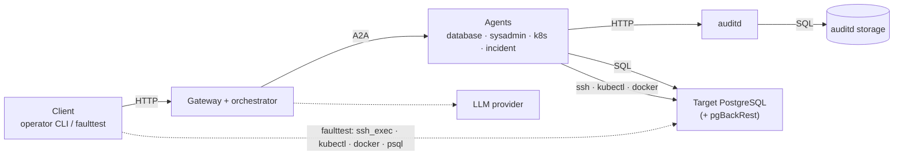

# aiHelpDesk platforms: where each piece runs and what is supported

aiHelpDesk is several cooperating pieces and each can run on a different platform: your laptop, Docker,
a VM, K8s. Which combinations work decides which way an agent reaches a database (SQL, `docker`,
SSH, `kubectl`), what has to be reachable from where and how much of the restore chain is available.
This page lists the pieces, how they reach each other and which combinations have been **run**, with
the evidence, as against those that are only implemented. It is not about governance posture (that is
[Deployment Modes](DEPLOYMENT_MODES.md)).

How to read the status column:

| Status | Meaning |
|---|---|
| **Verified** | Run end to end in a recorded test (run IDs and dates in [§5](#5-verified-combinations)) |
| **Implemented** | The code path exists and is unit/integration-tested, but has not been run in a recorded end-to-end test |
| **Not supported** | By design or known not to work |

## 1. The pieces

| Piece | What it is | Can run on |
|---|---|---|
| **Client** | the operator's `helpdesk-client` or the `faulttest` harness | laptop, a Docker container, a K8s Job (faulttest, via Helm) |
| **aiHelpDesk services** | gateway, orchestrator, the agents (database, sysadmin, k8s, incident, research) and auditd: the control plane and the governance half of the management plane ([Planes](PLANES.md)) | host processes (`startall.sh`, systemd), Docker Compose, K8s (Helm) |
| **auditd storage** | the audit and playbook-run database | SQLite (a file, a Docker volume, a PVC) or a **dedicated** Postgres |
| **Target PostgreSQL** | the database being diagnosed and repaired | a Docker/Podman container, a systemd VM or host, a K8s Pod, an operator-managed cluster, a managed cloud service |
| **pgBackRest** | the stanza and repository of a target | the same container, VM or pod as the target (a volume or local path); a remote repository is not handled by the restore ([§6](#6-not-supported-or-not-verified)) |
| **LLM provider** | the model behind the agents | external; the aiHelpDesk services need outbound access to it |

## 2. How they reach each other

The solid line from the agents to the target is how a diagnosis and a repair reach the database. The
dotted line from the client is faulttest breaking and repairing the target (and checking its recovery);
the operator CLI never touches the target.

**How the sysadmin agent picks the path**, from the target's entry in `infrastructure.json`
([SYSADMIN_AGENT.md](SYSADMIN_AGENT.md#2-infrastructure-config--vm-and-dbserver-fields)):

| The entry has | Path | Used for |
|---|---|---|
| a VM with `runtime: docker` / `podman` and a `container_name` | `docker` / `podman` on the agent's host | a container |
| a VM with `ssh_user` and `ssh_key_path` and a `systemd_unit` | SSH to the VM, then `systemctl` and the PostgreSQL log | a VM or host |
| a `k8s_pod_selector` (and `k8s_namespace`) | `kubectl`, with the agent's own ServiceAccount when in-cluster | a pod |
| none of these | SQL only (the database agent) | anything that has no host tier |

## 3. What aiHelpDesk can do per target

| Target | Diagnose (SQL) | Host state and logs | pgBackRest health + WAL check | Agent-driven restore | Status |
|---|---|---|---|---|---|
| Docker container | yes | `docker inspect/logs` | yes | yes | **Verified** |
| Podman container | yes | `podman` equivalents | yes | yes | **Implemented** (not run) |
| systemd VM or host | yes | SSH, `systemctl`, PostgreSQL log file | yes | yes (`restart_service`) | **Verified**, Ubuntu 24.04 / PostgreSQL 16; RHEL implemented, not run |
| K8s Pod (self-managed StatefulSet with pgBackRest) | yes | `kubectl logs` (crashed run first), pod phase | yes | yes: scale to 0, restore in a one-off pod, resume | **Verified**, single-node cluster |
| Operator-managed (CloudNativePG) | yes | pod state through the k8s agent | no (it uses Barman, not pgBackRest) | no | Diagnosis **Verified**; restore **Not supported** |
| Managed cloud service | yes | no host to inspect | no | no | SQL diagnosis only, by design; not run against a managed service |

## 4. Which services can reach which target

| aiHelpDesk services ↓ · Target → | Docker container | systemd VM (SSH) | K8s Pod |
|---|---|---|---|
| Host processes | **Verified** (same machine, restore chain, 2026-10-26) | **Verified** (restore chain, 2026-10-19 and 2026-10-25) | pgBackRest health and status tools **Verified** through the host's kubeconfig (2026-10-01 demo); the full restore chain from outside the cluster is **Implemented**, not run |
| Docker Compose | **Implemented**: exercised for diagnosis and incidents in the v0.29 three-platform round (September 2026), not re-run for the restore chain | **Implemented** (not run) | **Implemented** (not run) |
| K8s (Helm) | **Not supported** unless the node's Docker socket is mounted (`agents.sysadmin.dockerSocket.enabled`): **Implemented**, not run | **Verified**: needs the SSH Secret, a name or IP the pods resolve, a route and `pg_hba` for the cluster | **Verified**: same cluster, RBAC from the chart |

The chart gives the agents the permissions of their own cluster only. A target in a *different* cluster
needs a kubeconfig the chart does not provide: **Not supported**.

## 5. Verified combinations

Each row is a recorded run; the incident IDs are in the vault (`faulttest vault incidents <id> --summary`).

| Client | aiHelpDesk services | Target | Fault | Run |
|---|---|---|---|---|
| laptop | host processes | Docker container | `db-pgdata-corrupted` (restore) ×3, `db-pgdata-corrupted-unarchived-tail`, `db-pgbackrest-wal-gap` | `make faulttest-gateway-pgbackrest` |
| laptop | host processes | Ubuntu VM over SSH | `db-pgdata-corrupted-vm` (four hops) | `plr_c18ee2b4`, `plr_cea87922` |
| laptop | K8s | pod | `db-pgdata-corrupted-k8s` (four hops) | `plr_c0d8fb87`, `plr_508a10d2` |
| K8s Job | K8s | pod | `db-pgbackrest-wal-gap-k8s` | `plr_68e31a92` |
| K8s Job | K8s | pod | `db-pgdata-corrupted-k8s` (four hops, Decision Hub feedback) | `plr_cb23439f` |
| K8s Job | K8s | Ubuntu VM over SSH | `db-pgbackrest-wal-gap-vm` | `plr_85721afd` |
| K8s Job | K8s | Ubuntu VM over SSH | `db-pgdata-corrupted-vm` (four hops, Decision Hub feedback) | `plr_f8cee154` |
| `go test` in the repo | K8s | pod | restore refusal, `pg_wal` tail, resume, verify, and point-in-time restore of a crashed pod and of a **running** one (stop, scale to 0, one-off-pod restore, resume) (`make integration-k8s`, 28 checks; needs `K8S_SYSADMIN_API_KEY` on a release that enforces identity) | 2026-10-28 |
| `go test -tags integration` | tools called in-process (no agents, no LLM) | Docker container | point-in-time restore to a time and to an LSN, of a stopped and of a **running** instance (archive flushed, clean stop, restore in a throwaway container, `restart_container`), a target the archive never reaches then retried, and the catalog fault `db-pitr-dropped-table` from inject to `verify_sql` | `agents/sysadmin` `pitr_integration_test.go` |

Not yet run: the destructive teardown *repair* branch of `db-pgdata-corrupted-k8s` from a Job (the pod had
recovered, so the teardown found nothing to repair).

Point-in-time recovery (v0.33) is **not yet run** with a live model on any platform (the `faulttest`
fault `db-pitr-dropped-table` is built; its model-free proof is the Docker row above), and **not run at all
on a systemd VM** (the stop path is tested against a fake SSH server; the VM needs `systemctl stop <unit>`
in its sudoers file, which `setup-pgbackrest-vm.sh` now grants). The Kubernetes run above did not exercise
the flush-first branch (its target was already archived); Docker did.

### Where the faulttest client can run

| Client | `docker_exec` | `shell_exec` (`kubectl`, `psql`, `docker`) | `ssh_exec` | SQL | Status |
|---|---|---|---|---|---|
| Laptop (`go run` or the binary) | needs Docker | yes | yes | yes | **Verified** |
| K8s Job (Helm) | no: there is no Docker daemon | `kubectl` through the Job's ServiceAccount (a `Role` in `faulttest.targetNamespace`; the destructive faults need `faulttest.rbac.destructive`); `psql` | yes (key Secret `faulttest.ssh`) | yes | **Verified** |
| Docker container | needs the socket | yes | yes | yes | **Implemented** (see [DECISIONS.md](DECISIONS.md#k8s-and-docker--emit-and-wait)) |

A fault the Job runs must be selected with `faulttest.primaryInjection=true` unless it is marked
`external_compat` ([Helm README §10](../deploy/helm/README.md#10-fault-injection-testing-faulttest)).

### auditd storage

| Storage | Where | Status |
|---|---|---|
| SQLite | a file, a Docker volume, a PVC (the default) | **Verified** |
| Postgres | a dedicated instance: the `postgres-auditd` service in Compose or the StatefulSet in `deploy/helm/examples/postgres-auditd.yaml` | **Verified** on both |

**It must never be the same server as a target database.** A target outage must not take the audit trail
down with it. The chart asks for a separate namespace for this reason.

## 6. Not supported or not verified

- **A remote pgBackRest repository** (S3, GCS, Azure) for the K8s restore: the one-off restore pod
  mounts the StatefulSet's volumes and has no repository credentials. **Not supported** ([BACKUP.md](BACKUP.md#4-roadmap)).
- **A ReadWriteOnce volume on a multi-node cluster:** the one-off pod is not pinned to the instance's
  node. **Not supported**.
- **Podman and RHEL/Red Hat VMs:** implemented, but only Docker and Ubuntu were exercised.
- **A target in another cluster than the aiHelpDesk services** and **a Docker target from in-cluster services** without mounting the node's socket: **Not supported**.
- **Restore on operator-managed or managed-service databases** (CloudNativePG, RDS, Cloud SQL, AlloyDB as a
  service): no pgBackRest, no host. They get SQL diagnosis only.
- **The harness does not verify a VM's host key** (`ssh_exec` runs with `StrictHostKeyChecking=no`); the
  sysadmin agent does, against its `known_hosts`.

## 7. Before you cross a boundary

| You are connecting | Read |
|---|---|
| a cluster to a VM | [Helm README §3.7a](../deploy/helm/README.md#37a-ssh-to-hosts-and-vms-sysadmin-agent) and [§10.6](../deploy/helm/README.md#106-a-vm-fault-from-a-job-entirely-in-cluster): the SSH Secrets, the VM's name resolving in-cluster (a `.test` name in your `/etc/hosts` does not), a route and `pg_hba` for the cluster |
| a cluster to a pod target | [Helm README §10.7](../deploy/helm/README.md#107-a-pod-fault-from-a-job-entirely-in-cluster): the inventory's `k8s_pod_selector`, the Role |
| a laptop harness to a cluster | a kubeconfig context for `shell_exec` and a port-forward to the gateway |
| auditd to Postgres | [Helm README](../deploy/helm/README.md) and `deploy/helm/examples/postgres-auditd.yaml` |

## 8. Failure domains

Where the services run relative to the databases decides what survives a failure. aiHelpDesk is needed
*during* a data-plane incident, so the services that act should not share the failure they are there to
repair ([Planes §2.1](PLANES.md#21-why-the-usual-ordering-does-not-hold)):

- **auditd's storage** never shares a server with a target database (a rule, §5).
- **The agents** should not run on the node, host or cluster whose loss they must respond to. The in-cluster
  demo puts them in the same cluster as the target pod: that covers a crashed pod or a corrupted data
  directory, not a node or cluster failure. A VM target reached over SSH from a cluster does not have
  this coupling.
- **The model provider** is outside every one of these domains and has no failover.
