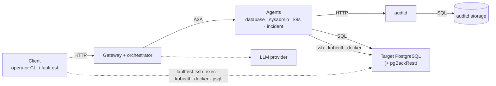

# aiHelpDesk platforms: where each piece runs and what is supported

aiHelpDesk is several cooperating pieces and each can run on a different platform: your laptop, Docker,
a VM, K8s. Which combinations work decides which way an agent reaches a database (SQL, `docker`,
SSH, `kubectl`), what has to be reachable from where and how much of the restore chain is available.
This page lists the pieces, how they reach each other and which combinations have been **run**, with
the evidence, as against those that are only implemented. It is not about governance posture (that is
[Deployment Modes](DEPLOYMENT_MODES.md)).

How to read the status column:

| Status | Meaning |
|---|---|
| **Verified** | Run end to end in a recorded test (run IDs and dates in [§5](#5-verified-combinations)) |
| **Implemented** | The code path exists and is unit/integration-tested, but has not been run in a recorded end-to-end test |
| **Not supported** | By design or known not to work |

## 1. The pieces

| Piece | What it is | Can run on |
|---|---|---|
| **Client** | the operator's `helpdesk-client` or the `faulttest` harness | laptop, a Docker container, a K8s Job (faulttest, via Helm) |
| **aiHelpDesk services** | gateway orchestrator, the agents (database, sysadmin, k8s, incident, research) and auditd: the control plane and the governance half of the management plane ([Planes](PLANES.md)) | host processes (`startall.sh`, systemd), Docker Compose, K8s (Helm) |
| **auditd storage** | the audit and playbook-run database | SQLite (a file, a Docker volume, a PVC) or a **dedicated** Postgres |
| **Target PostgreSQL** | the database being diagnosed and repaired | a Docker/Podman container, a systemd VM or host, a K8s Pod, an operator-managed cluster, a managed cloud service |
| **pgBackRest** | the stanza and repository of a target | the same container, VM or pod as the target (a volume or local path); a remote repository is not handled by the restore ([§6](#6-not-supported-or-not-verified)) |
| **LLM provider** | the model behind the agents | external; the aiHelpDesk services need outbound access to it |

## 2. How they reach each other

The solid line from the agents to the target is how a diagnosis and a repair reach the database. The
dotted line from the client is faulttest breaking and repairing the target (and checking its recovery);
the operator CLI never touches the target.

**How the sysadmin agent picks the path**, from the target's entry in `infrastructure.json`
([SYSADMIN_AGENT.md](SYSADMIN_AGENT.md#2-infrastructure-config--vm-and-dbserver-fields)):

| The entry has | Path | Used for |
|---|---|---|
| a VM with `runtime: docker` / `podman` and a `container_name` | `docker` / `podman` on the agent's host | a container |
| a VM with `ssh_user` and `ssh_key_path` and a `systemd_unit` | SSH to the VM, then `systemctl` and the PostgreSQL log | a VM or host |
| a `k8s_pod_selector` (and `k8s_namespace`) | `kubectl`, with the agent's own ServiceAccount when in-cluster | a pod |
| none of these | SQL only (the database agent) | anything that has no host tier |

**Services on a laptop, database on a Linux VM.** A common host-process setup: the gateway and agents run on your
laptop (unpacked from `make binaries`, started with `startall.sh`) and the database and pgBackRest repository run on
a VM reached over SSH. The agent needs a route to the VM's SSH port and PostgreSQL port and the VM's name resolving on
the laptop. The agent checks the VM's host key against `~/.ssh/known_hosts` (or `SSH_KNOWN_HOSTS`) and, if that file
is absent, logs a warning and skips the check. Set both `HELPDESK_INFRA_CONFIG` (in the `.env` that
`startall.sh` reads) and each VM's `ssh_key_path` to **absolute** paths: a relative path resolves against the agent's
working directory and fails with a key-read error (`check_host` reports it). An agent started before the setting
changed keeps the old infra file, so restart it and check `HELPDESK_INFRA_CONFIG` in its environment. A laptop that
sleeps or a VM that hibernates, shows up as an SSH `i/o timeout` and nothing else.

## 3. What aiHelpDesk can do per target

| Target | Diagnose (SQL) | Host state and logs | pgBackRest health + WAL check | Agent-driven restore | Status |
|---|---|---|---|---|---|
| Docker container | yes | `docker inspect/logs` | yes | yes | **Verified** |
| Podman container | yes | `podman` equivalents | yes | yes | **Implemented** (not run) |
| systemd VM or host | yes | SSH, `systemctl`, PostgreSQL log file | yes | yes (`restart_service`) | **Verified**, Ubuntu 24.04 / PostgreSQL 16; RHEL implemented, not run |
| K8s Pod (self-managed StatefulSet with pgBackRest) | yes | `kubectl logs` (crashed run first), pod phase | yes | yes: scale to 0, restore in a one-off pod, resume | **Verified**, single-node cluster |
| Operator-managed (CloudNativePG) | yes | pod state through the k8s agent | no (it uses Barman, not pgBackRest) | no | Diagnosis **Verified**; restore **Not supported** |
| Managed cloud service | yes | no host to inspect | no | no | SQL diagnosis only, by design; not run against a managed service |

**What the transaction count needs on the target.** A point-in-time plan counts the transactions a restore would
discard by decoding the WAL with `pg_waldump` on the instance ([PITR.md §4](PITR.md#4-operating-it)). It needs the
binary of the server's own major version, and says why it did not count when it is not there:

| Target | `pg_waldump` is | Status |
|---|---|---|
| Docker container | in the server image, at `/usr/lib/postgresql/N/bin` on Debian-based images (found there by the server's major version) | **Verified** on the pgBackRest fixture (PostgreSQL 16, Debian); present, not run through the count, on `postgres:16-alpine` (`/usr/local/bin`, found on `PATH`) and AlloyDB Omni 17 |
| systemd VM or host | in the server package: `/usr/lib/postgresql/N/bin` on Debian and Ubuntu (not on `PATH` for the `postgres` user, so found by path), `/usr/pgsql-N/bin` on RHEL | Debian and Ubuntu **Verified** (Ubuntu 24.04, PostgreSQL 16.15, over SSH); RHEL path implemented, not run |
| K8s Pod (self-managed) | in the server image, as for Docker; run through `kubectl exec` while the pod is ready and in a one-off pod on its volumes when it is not | **Verified** through `kubectl exec` into a ready pod (PostgreSQL 16.14, Debian image); the one-off-pod path for a pod that is not ready is not run |
| Operator-managed (CloudNativePG), managed cloud service | not available to aiHelpDesk (no pgBackRest repository to decode from, no host) | not counted: the plan says so and keeps the archive-based figures |

## 4. Which services can reach which target

| aiHelpDesk services ↓ · Target → | Docker container | systemd VM (SSH) | K8s Pod |
|---|---|---|---|
| Host processes | **Verified** (same machine, restore chain, 2026-10-26) | **Verified** (restore chain, 2026-10-19 and 2026-10-25) | pgBackRest health and status tools **Verified** through the host's kubeconfig (2026-10-01 demo); the full restore chain from outside the cluster is **Implemented**, not run |
| Docker Compose | **Implemented**: exercised for diagnosis and incidents in the v0.29 three-platform round (September 2026), not re-run for the restore chain | **Implemented** (not run) | **Implemented** (not run) |
| K8s (Helm) | **Not supported** unless the node's Docker socket is mounted (`agents.sysadmin.dockerSocket.enabled`): **Implemented**, not run | **Verified**: needs the SSH Secret, a name or IP the pods resolve, a route and `pg_hba` for the cluster | **Verified**: same cluster, RBAC from the chart |

The chart gives the agents the permissions of their own cluster only. A target in a *different* cluster
needs a kubeconfig the chart does not provide: **Not supported**.

## 5. Verified combinations

Each row is a recorded run; the incident IDs are in the vault (`faulttest vault incidents <id> --summary`).

| Client | aiHelpDesk services | Target | Fault | Run |
|---|---|---|---|---|
| laptop | host processes | Docker container | `db-pgdata-corrupted` (restore) ×3, `db-pgdata-corrupted-unarchived-tail`, `db-pgbackrest-wal-gap` | `make faulttest-gateway-pgbackrest` |
| laptop | host processes | Ubuntu VM over SSH | `db-pgdata-corrupted-vm` (four hops) | `plr_c18ee2b4`, `plr_cea87922` |
| laptop | K8s | pod | `db-pgdata-corrupted-k8s` (four hops) | `plr_c0d8fb87`, `plr_508a10d2` |
| K8s Job | K8s | pod | `db-pgbackrest-wal-gap-k8s` | `plr_68e31a92` |
| K8s Job | K8s | pod | `db-pgdata-corrupted-k8s` (four hops, Decision Hub feedback) | `plr_cb23439f` |
| K8s Job | K8s | Ubuntu VM over SSH | `db-pgbackrest-wal-gap-vm` | `plr_85721afd` |
| K8s Job | K8s | Ubuntu VM over SSH | `db-pgdata-corrupted-vm` (four hops, Decision Hub feedback) | `plr_f8cee154` |
| laptop | K8s | pod | `db-pitr-dropped-table-k8s` (a table dropped on the running pod: plan, gate held at `recovery_target_required`, running pod flushed, stopped and restored to the target, resumed, rows checked), 121.9s after injection | `plr_5e4dba37` (remediation `plr_bcbb05cf`), 2026-10-28 |
| laptop | host processes | Docker container | `db-pitr-dropped-table` (a table dropped on the running container: plan, gate held, running container flushed, stopped and restored in a throwaway container, restarted, rows checked), 106.1s after injection | `plr_245be7fb` (remediation `plr_52c37957`), 2026-10-28 |
| laptop | host processes | Ubuntu VM over SSH | point-in-time restore of a table dropped on the running VM, started by hand: triage with a time target, plan read with `helpdesk-client --pitr-plan`, gate approved with `--pitr-approve ... --allow-stop-serving`; live instance flushed, stopped with `sudo systemctl stop`, restored from an incremental backup, restarted; log and rows checked by hand (timeline 44 to 45) | `plr_2577a3bc` (remediation `plr_1516145c`), 2026-10-29 |
| laptop | host processes | Ubuntu VM over SSH | `db-pitr-dropped-table-vm` (v0.34; no objective on the VM entry, so the plan shows the loss and compares with the 1h default): plan, gate held, running instance flushed, stopped with `sudo systemctl stop`, restored in place, restarted, rows checked by `verify_sql`; `recovery_decision` trail checked (plan, gate, execution, outcome; chain verifies), 106 to 110s after injection | `plr_0d09e035` (remediation `plr_c18e7bbd`), 2026-11-09 |
| laptop | host processes | Ubuntu VM over SSH | `db-pitr-dropped-table-vm` with `rpo: 1s`, `enforcement: acknowledge` on the VM entry: plan `exceeds` (8s against 1s), the harness acknowledged the breach as the operator, the loss re-measured at 1m 10s before the stop, recovery 39s against an RTO of 30m; trail checked | `plr_630c3539` (remediation `plr_cf7bac2a`), 2026-11-09 |
| laptop | host processes | Ubuntu VM over SSH | the same, after the attribution classes were described: the run is filed `pitr-plan-feasible` (`plr_630c3539` had been filed `pitr-plan-not-feasible`) | `plr_69ea0730` (remediation `plr_3321e843`), 2026-11-09 |
| laptop | host processes | Ubuntu VM over SSH | `db-pitr-dropped-table-vm-lsn` (an LSN target, same objective): verdict `not_comparable` (the target segment was not archived yet, so no lower bound), no second yes asked for, restore stopped at `0/3C000028`, 40 bytes past the target (the first record after a segment's page header); trail checked | `plr_fb5a9f6b` (remediation `plr_eb2a2741`), 2026-11-09 |
| laptop | host processes | Ubuntu VM over SSH | `db-pitr-dropped-table-vm-lsn` again, after the verifier accepted a stop past a segment-boundary LSN: same verdict and stop (`0/3F000028` for a target of `0/3F000000`), and this time no `restore_recovery_mismatch` signal (the first run had raised one for a correct restore); trail checked | `plr_79c8eda2` (remediation `plr_baeffd99`), 2026-11-09 |
| laptop | host processes | Ubuntu VM over SSH | `db-pitr-dropped-table-vm-lsn` with the target read from `pg_current_wal_insert_lsn()` (the write position, `pg_current_wal_lsn()`, read as a segment's bare start on every earlier run): the target is a record start (`0/42000028`), the restore stopped at it exactly, `verify_restore_recovery` verified it with no gap to explain; trail checked | `plr_998dce3a` (remediation `plr_2b432931`), 2026-11-09 |
| `curl` from a laptop to the sysadmin agent's `/tool` endpoint | K8s (the agent in minikube, reaching the VM over SSH) | Ubuntu VM over SSH | the v0.35 transaction count: five commits made on purpose after a target time, then `plan_point_in_time_recovery` for that time (no fault, no model, nothing restored): `feasible`, `transactions` measured, **5 commits, exact** (the running instance is read to its own position), decoded from two archived segments and the live `pg_wal` by `pg_waldump` 16.15 in 181 ms; the five commit LSNs sit directly before the position the `pg_switch_wal()` that followed returned | 2026-11-11 |
| `curl` from a laptop to the sysadmin agent's `/tool` endpoint | K8s (the agent in minikube, `kubectl exec` into the pod) | K8s Pod (`pgbackrest-demo-0`) | the same v0.35 transaction count on the pod: five commits after a target time, `plan_point_in_time_recovery` for it: `feasible`, **5 commits, exact**, two segments read in 1167 ms by `pg_waldump` 16.14; the commit LSNs sit directly before the position the following `pg_switch_wal()` returned | 2026-11-11 |
| `go test -tags integration` | tools called in-process (no agents, no LLM) | Docker container | the same count against real WAL: commits before and after a target time read by the real script (`docker exec`, the real `pg_waldump` and `pgbackrest archive-get`); the ones before the target are read and not counted, the ones after are counted, and commits that exist only in the running instance's `pg_wal` (never archived) are counted by the serving read and not by the archive-only one (`TestIntegration_CountsTransactionsFromRealWAL`, stable over eight runs) | 2026-11-11 |
| `go test` in the repo | K8s | pod | restore refusal, `pg_wal` tail, resume, verify and point-in-time restore of a crashed pod and of a **running** one (stop, scale to 0, one-off-pod restore, resume) (`make integration-k8s`, 28 checks; needs `K8S_SYSADMIN_API_KEY` on a release that enforces identity) | 2026-10-28 |
| `go test -tags integration` | tools called in-process (no agents, no LLM) | Docker container | point-in-time restore to a time and to an LSN, of a stopped and of a **running** instance (archive flushed, clean stop, restore in a throwaway container, `restart_container`), a target the archive never reaches then retried and the catalog fault `db-pitr-dropped-table` from inject to `verify_sql` | `agents/sysadmin` `pitr_integration_test.go` |

Not yet run: the destructive teardown *repair* branch of `db-pgdata-corrupted-k8s` from a Job (the pod had
recovered, so the teardown found nothing to repair).

Point-in-time recovery (v0.33) has run with a live model once on a K8s Pod, once on the Docker fixture (100%
remediation each; both plans reported `archive_flush_required=true`, so the flush-first branch has run on both) and
once on a systemd VM over SSH, the last by hand. Since v0.34 the VM has catalog faults too (`db-pitr-dropped-table-vm`
and `-vm-lsn`, run from the `faulttest` CLI with `--external=false`; see [FAULTTEST.md §6.6](FAULTTEST.md#point-in-time-faults-on-a-vm)),
and the four runs above are those. The VM needs `systemctl stop <unit>` in its sudoers file, which
`setup-pgbackrest-vm.sh` grants. One run per case says the chain works, not how often. The v0.34 objective check
(`exceeds` with the second yes, `not_comparable` for an LSN) has run live on the Docker fixture and on the VM, not yet on a
K8s Pod. The v0.35 transaction count (`data_loss_estimate.transactions`, [PITR.md §4](PITR.md#4-operating-it)) has
run on the Docker fixture, on the VM and on a K8s Pod; its parser was also compared, read-only, on PostgreSQL
16.14 (Debian), 16.15 (Ubuntu) and 18.6 (Debian) and found to agree.

### Where the faulttest client can run

| Client | `docker_exec` | `shell_exec` (`kubectl`, `psql`, `docker`) | `ssh_exec` | SQL | Status |
|---|---|---|---|---|---|
| Laptop (`go run` or the binary) | needs Docker | yes | yes | yes | **Verified** |
| K8s Job (Helm) | no: there is no Docker daemon | `kubectl` through the Job's ServiceAccount (a `Role` in `faulttest.targetNamespace`; the destructive faults need `faulttest.rbac.destructive`); `psql` | yes (key Secret `faulttest.ssh`) | yes | **Verified** |
| Docker container | needs the socket | yes | yes | yes | **Implemented** (see [DECISIONS.md](DECISIONS.md#k8s-and-docker--emit-and-wait)) |

A fault the Job runs must be selected with `faulttest.primaryInjection=true` unless it is marked
`external_compat` ([Helm README §10](../deploy/helm/README.md#10-fault-injection-testing-faulttest)).

### auditd storage

| Storage | Where | Status |
|---|---|---|
| SQLite | a file, a Docker volume, a PVC (the default) | **Verified** |
| Postgres | a dedicated instance: the `postgres-auditd` service in Compose or the StatefulSet in `deploy/helm/examples/postgres-auditd.yaml` | **Verified** on both |

**It must never be the same server as a target database.** A target outage must not take the audit trail
down with it. The chart asks for a separate namespace for this reason.

## 6. Not supported or not verified

- **A remote pgBackRest repository** (S3, GCS, Azure) for the K8s restore: the one-off restore pod
  mounts the StatefulSet's volumes and has no repository credentials. **Not supported** ([BACKUP.md](BACKUP.md#4-roadmap)).
- **A ReadWriteOnce volume on a multi-node cluster:** the one-off pod is not pinned to the instance's
  node. **Not supported**.
- **Podman and RHEL/Red Hat VMs:** implemented, but only Docker and Ubuntu were exercised.
- **A target in another cluster than the aiHelpDesk services** and **a Docker target from in-cluster services** without mounting the node's socket: **Not supported**.
- **Restore on operator-managed or managed-service databases** (CloudNativePG, RDS, Cloud SQL, AlloyDB as a
  service): no pgBackRest, no host. They get SQL diagnosis only.
- **The harness does not verify a VM's host key** (`ssh_exec` runs with `StrictHostKeyChecking=no`); the
  sysadmin agent does, against its `known_hosts`.

## 7. Before you cross a boundary

| You are connecting | Read |
|---|---|
| a cluster to a VM | [Helm README §3.7](../deploy/helm/README.md#37-ssh-to-hosts-and-vms-sysadmin-agent) and [§10.6](../deploy/helm/README.md#106-a-vm-fault-from-a-job-entirely-in-cluster): the SSH Secrets, the VM's name resolving in-cluster (a `.test` name in your `/etc/hosts` does not), a route and `pg_hba` for the cluster |
| a cluster to a pod target | [Helm README §10.7](../deploy/helm/README.md#107-a-pod-fault-from-a-job-entirely-in-cluster): the inventory's `k8s_pod_selector`, the Role |
| a laptop harness to a cluster | a kubeconfig context for `shell_exec` and a port-forward to the gateway |
| auditd to Postgres | [Helm README](../deploy/helm/README.md) and `deploy/helm/examples/postgres-auditd.yaml` |

## 8. Failure domains

Where the services run relative to the databases decides what survives a failure. aiHelpDesk is needed
*during* a data-plane incident, so the services that act should not share the failure they are there to
repair ([Planes §2.1](PLANES.md#21-why-the-usual-ordering-does-not-hold)):

- **auditd's storage** never shares a server with a target database (a rule, §5).
- **The agents** should not run on the node, host or cluster whose loss they must respond to. The in-cluster
  demo puts them in the same cluster as the target pod: that covers a crashed pod or a corrupted data
  directory, not a node or cluster failure. A VM target reached over SSH from a cluster does not have
  this coupling.
- **The model provider** is outside every one of these domains and has no failover.
